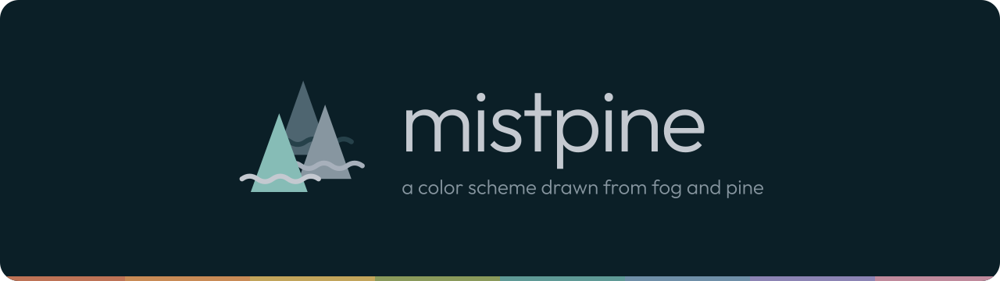
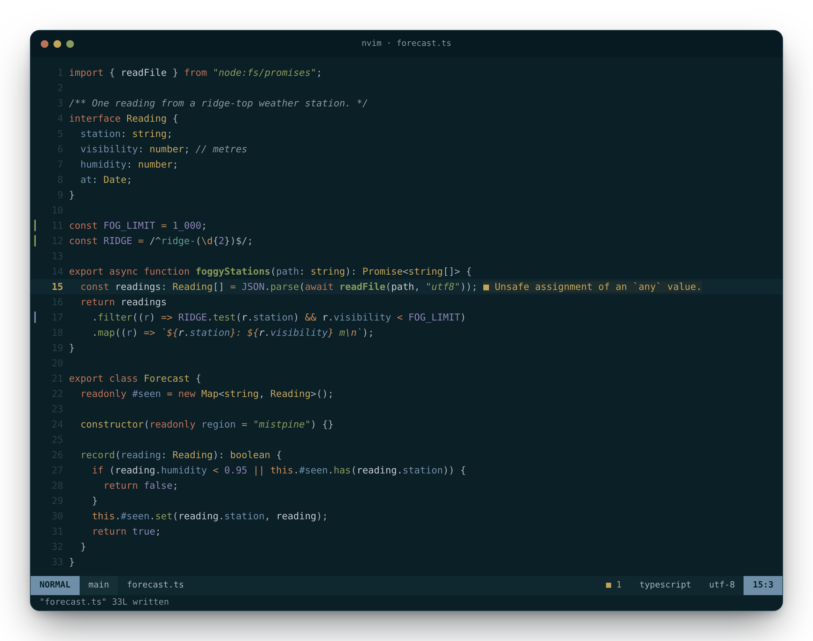
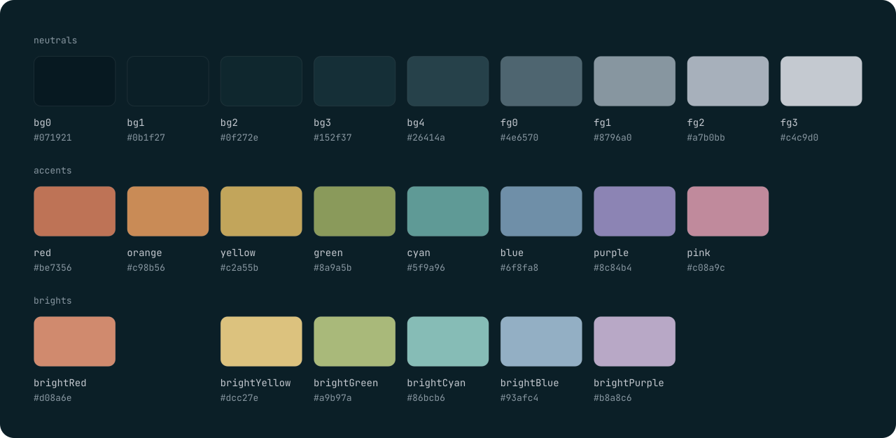

<p align="center">
  
</p>

<p align="center">
  <a href="#palette">Palette</a> ·
  <a href="#ports">Ports</a> ·
  <a href="#use-the-palette">Use the palette</a> ·
  <a href="docs/spec.md">Spec</a> ·
  <a href="docs/brand.md">Brand</a>
</p>

<p align="center">
  
</p>

**mistpine** is a dark color scheme of cool, misty grays over a deep
blue-green night, with muted, earthy accents: clay, amber, ochre, moss, teal,
slate and heather. Saturation stays low and every syntax color clears 4.5:1
on the background, so code reads calmly for hours.

This repository is the reference for mistpine: the palette, the full color
spec that every port follows, palette files for your own tools, and the logo.

## Palette

<p align="center">
  
</p>

<!-- BEGIN:palette -->
|  | Neutral | Hex | Used for |
| :-: | --- | --- | --- |
|  | `bg0` | `#071921` | Panels, floats, inactive tabs |
|  | `bg1` | `#0b1f27` | Editor and terminal background |
|  | `bg2` | `#0f272e` | Cursor line, status line, menus, ANSI black |
|  | `bg3` | `#152f37` | Visual selection, menu selection |
|  | `bg4` | `#26414a` | Borders, line numbers, terminal selection |
|  | `fg0` | `#4e6570` | Decoration only (the logo's back pine): too dim for text |
|  | `fg1` | `#8796a0` | Comments |
|  | `fg2` | `#a7b0bb` | Punctuation, status line text, ANSI white |
|  | `fg3` | `#c4c9d0` | Text, variables, cursor |

|  | Accent | Hex |  | Bright | Hex | Used for |
| :-: | --- | --- | :-: | --- | --- | --- |
|  | `red` | `#be7356` |  | `brightRed` | `#d08a6e` | Keywords, control flow, errors, deletions |
|  | `orange` | `#c98b56` |  |  |  | Operators, builtins, escapes, current search match |
|  | `yellow` | `#c2a55b` |  | `brightYellow` | `#dcc27e` | Types, attributes, warnings, current line number |
|  | `green` | `#8a9a5b` |  | `brightGreen` | `#a9b97a` | Functions, strings, headings, additions |
|  | `cyan` | `#5f9a96` |  | `brightCyan` | `#86bcb6` | Tags, macros, regexes, links, hints |
|  | `blue` | `#6f8fa8` |  | `brightBlue` | `#93afc4` | Parameters, properties, modules, info, accent |
|  | `purple` | `#8c84b4` |  | `brightPurple` | `#b8a8c6` | Numbers, constants, booleans |
|  | `pink` | `#c08a9c` |  |  |  | Spare accent for app-specific highlights |
<!-- END:palette -->

### Terminal

<!-- BEGIN:terminal -->
|  | 0 black | 1 red | 2 green | 3 yellow | 4 blue | 5 magenta | 6 cyan | 7 white |
| --- | :-: | :-: | :-: | :-: | :-: | :-: | :-: | :-: |
| **normal** | <br>`#0f272e` | <br>`#be7356` | <br>`#8a9a5b` | <br>`#c2a55b` | <br>`#6f8fa8` | <br>`#9a88a8` | <br>`#5f9a96` | <br>`#a7b0bb` |
| **bright** | <br>`#546b76` | <br>`#d08a6e` | <br>`#a9b97a` | <br>`#dcc27e` | <br>`#93afc4` | <br>`#b8a8c6` | <br>`#86bcb6` | <br>`#d0d1d6` |

Background `#0b1f27`, foreground `#c4c9d0`, cursor `#c4c9d0` on `#0b1f27`, selection `#26414a` with `#d0d1d6` text.
<!-- END:terminal -->

Syntax, editor UI, diagnostics and diff colors, with contrast ratios, are in
the [spec](docs/spec.md).

## Ports

| App    | Port                                                          | Status    |
| ------ | ------------------------------------------------------------- | --------- |
| Neovim | [`mistpine.nvim`](https://github.com/lnutimura/mistpine.nvim) | Available |

Until an app has its own port, open mistpine in
[themes.utimura.io](https://themes.utimura.io/#s=lVRNj-M2DP0vao6ejO04_jrtboH2VhTFXNpLQMl0oo4tuRI92WCQ_16IzjrxJt3tAgEcvkdSFPXId7Hy6oA9iFociAZfPz_TAXv065F0PzpYa_s8uTy_Jeu_vTUiEm_ovLZG1EkkDPQoatFrT4M2GFhwGgyJWjTgXkUkBuiQCEX9LuQ-FrX4KS6SKk1EJOQ-YVsmbVqwnbLdpkWKbG-CnWzTdjPxWbDTPEsyEJFoJ15lqmpitjkeChlLyTbnL4sqh4nn8zPMt0WwHTbBllhstrmIhHVg9sgpq1IydMKus0eGUthuQ9a9QzScFypgRJ2AgW1bQRWiZDdymrwtWyhDE0Y3dAyVqsxkFiBtXjlvXEKlQpDT-wP9MdXUxCXkOKO_fjkTKlkVMON_zuU1SqXFNeDTpYJqA63KZvj3uQ5ZQqnymfj5coUyl0rm4hwJ-4bO6QZ9eDlC12sD3RqM1_HikRZUsujngkoXLVtQm0V_F1S2aOOC2vL9oCzvqWQ79bBJmkUdHjtUpK35tBe1WAU9RWLU604b_M19VKTfQnNWl1ePxBFRHYDWX74SXO0JaPRrZTvrdvKSaPMfzqSpw2_4yrHttKdajc6hoYWPPxmCz-tXPB2tC6pYBcHOuLKGnO0e4H2PPIGrMAAz3o6G7x6IScMz1SMdbPOAMGMv0QXiouDb0z1Ng37HSWs7ZD3dU6PuSDN1mbaZGpwd0NGJGxDke2XAQY80FbKkeN1IlvSH-Zlb63Dv7GhuuhJyA1n36OSwxfwACu_zE_CD8IRf2wXK2XsYvYIBHx1wQGi02d82-FGxt7ts5tXoPJf9gJv1_Mv-seDDMJS8mrJcFvmkdmPNC34mXqVFlmTVA-2yYuvwd0ead_w1xTd8jVavO9u2YaD-b4w2wIO3O2rTTMvsh8Lk2LYsje-FheLCsO3gCKeH_tqpi69D8Nbs_hk1fceT7KDVznbNjd85Ep5O3bQ753l8F5qg00rU5EZkH8equCOuo_ouJKdm4hyJHgk4qUMgbD6G6tI4zZ-S-GkTv8Rxzb91HMd_hdcemq_ckqc4e0nyenN1O5__BQ) and export it: the designer
writes ready-to-apply configs for Ghostty, herdr, Neovim, WeeChat, Cursor
Agent and Claude Code, plus base16, base24 and CSS.

Writing a port? Follow the [spec](docs/spec.md), read colors from
[`palette/mistpine.json`](palette/mistpine.json) and name the repository
`mistpine.<app>` (see [brand](docs/brand.md#port-lockups)).

## Use the palette

| File                                                                                             | What it is                                                                                  |
| ------------------------------------------------------------------------------------------------ | ------------------------------------------------------------------------------------------- |
| [`palette/mistpine.json`](palette/mistpine.json)                                                 | The spec: palette, terminal, syntax and UI colors, each with the palette key it comes from  |
| [`palette/mistpine.css`](palette/mistpine.css)                                                   | CSS custom properties: `--mistpine-bg1`, `--mistpine-syntax-keyword`, …                     |
| [`palette/mistpine.scss`](palette/mistpine.scss)                                                 | Sass variables and a `$mistpine-palette` map                                                |
| [`palette/mistpine.lua`](palette/mistpine.lua)                                                   | A Lua table for Neovim configs and plugins                                                  |
| [`mistpine.base16.yaml`](palette/mistpine.base16.yaml), [`base24`](palette/mistpine.base24.yaml) | [tinted-theming](https://github.com/tinted-theming/home) schemes for base16/base24 builders |
| [`mistpine.theme.json`](mistpine.theme.json)                                                     | The editable source: drop it on [themes.utimura.io](https://themes.utimura.io) to tweak it  |

```css
:root {
  --mistpine-ui-editor-bg: #0b1f27; /* … from palette/mistpine.css */
}

pre {
  background: var(--mistpine-ui-editor-bg);
  color: var(--mistpine-ui-editor-fg);
}
```

```lua
local mistpine = dofile("path/to/mistpine/palette/mistpine.lua")
vim.api.nvim_set_hl(0, "Comment", mistpine.syntax.comment) -- { fg = "#8796a0", italic = true }
```

## Brand

<p align="center">
  
</p>

Three pines, one behind the other, with fog drifting between them. Logos,
lockups, colors and usage rules are in [docs/brand.md](docs/brand.md).

## Development

Requires Node 24+ and pnpm (`corepack enable`).

```sh
pnpm install
pnpm build    # palette files, logos, swatches and the tables in this README
pnpm render   # assets/preview.png and social-preview.png (needs Neovim 0.11+ and Chromium)
pnpm lint && pnpm typecheck
```

`mistpine.theme.json` is the source of truth. `pnpm sync` resolves it into
`palette/mistpine.json` with the themes app's own resolver (it needs a
checkout of the app, `THEMES_DIR=../themes` by default), and `pnpm build`
derives everything else from that file. CI fails if a generated file is out of
date.

## Credits

- Designed in [themes.utimura.io](https://themes.utimura.io).
- [Outfit](https://github.com/Outfitio/Outfit-Fonts) and
  [JetBrains Mono](https://github.com/JetBrains/JetBrainsMono), both under the
  SIL Open Font License 1.1, for the wordmark and labels. The logos have their
  text outlined; subsets of the fonts used to build them are in
  [`scripts/fonts`](scripts/fonts).

## License

[MIT](LICENSE)
