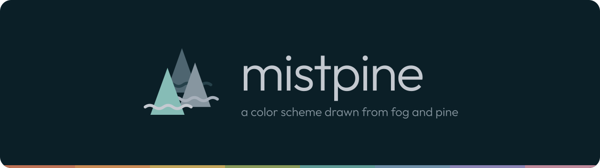
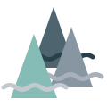
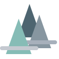
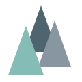
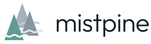
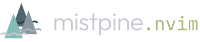

# mistpine brand

  

## The mark

Three overlapping pines: a tall one at the back in the middle, one to the
right, and one in front on the left, with wavy fog drifting between them. Each
layer of fog is lighter than the one behind it, as mist is in a forest.

  
  &nbsp;&nbsp;&nbsp;
  
  &nbsp;&nbsp;&nbsp;
  

| File                                              | Use                                                  |
| ------------------------------------------------- | ---------------------------------------------------- |
| [`mark.svg`](../assets/logo/mark.svg)             | On dark backgrounds, 64 px and up                    |
| [`mark-light.svg`](../assets/logo/mark-light.svg) | On light backgrounds (`#d0d1d6` or lighter)          |
| [`mark-32.svg`](../assets/logo/mark-32.svg)       | Around 32 px: the fog becomes straight lines         |
| [`mark-16.svg`](../assets/logo/mark-16.svg)       | 16 px and favicons: pines only                       |
| [`avatar.svg`](../assets/logo/avatar.svg)         | App icon and avatar: the mark on a raised `bg2` tile |

### Colors

| Part       | Dark                   | Light            |
| ---------- | ---------------------- | ---------------- |
| Back pine  | `fg0` `#4e6570`        | `fg2` `#a7b0bb`  |
| Back fog   | `bg4` `#26414a`        | `fg3` `#c4c9d0`  |
| Right pine | `fg1` `#8796a0`        | `fg1` `#8796a0`  |
| Mid fog    | `fg2` `#a7b0bb`        | `#e2e3e7`        |
| Front pine | `brightCyan` `#86bcb6` | `cyan` `#5f9a96` |
| Front fog  | `fg3` `#c4c9d0`        | `#f2f2f4`        |
| Wordmark   | `fg3` `#c4c9d0`        | `bg1` `#0b1f27`  |

The light version is drawn for a `#d0d1d6` card: its fog is lighter than the
card, so on pure white it fades into the background outside the pines.

## Lockups

  <picture>
    <source media="(prefers-color-scheme: dark)" srcset="../assets/logo/lockup.svg">
    
  </picture>

| File                                                  | Use                               |
| ----------------------------------------------------- | --------------------------------- |
| [`lockup.svg`](../assets/logo/lockup.svg)             | Mark and wordmark, on dark        |
| [`lockup-light.svg`](../assets/logo/lockup-light.svg) | Mark and wordmark, on light       |
| [`banner.svg`](../assets/banner.svg)                  | README header, 1280 × 360         |
| [`social-preview.png`](../assets/social-preview.png)  | GitHub social preview, 1280 × 640 |

### Port lockups

Ports are named `mistpine.<app>`. The suffix is set in JetBrains Mono, in a
bright accent:

| Port                | Suffix color             |
| ------------------- | ------------------------ |
| `mistpine.nvim`     | `brightGreen` `#a9b97a`  |
| `mistpine.obsidian` | `brightRed` `#d08a6e`    |
| `mistpine.ghostty`  | `brightBlue` `#93afc4`   |
| `mistpine.vscode`   | `brightYellow` `#dcc27e` |
| `mistpine.wezterm`  | `brightPurple` `#b8a8c6` |
| `mistpine.tmux`     | `brightCyan` `#86bcb6`   |

  

`lockupSvg()` in [`scripts/lib/brand.ts`](../scripts/lib/brand.ts) draws a
lockup for any suffix.

## Type

- **Wordmark:** Outfit Light (300), always lowercase, tracked −0.02 em
  (−0.03 em at display sizes).
- **Suffixes, labels and code:** JetBrains Mono Regular.

All logos have their text converted to outlines, so they need no fonts.

## Usage

- Keep the mark's proportions, layer order and colors. No outlines, shadows
  or gradients.
- Leave clear space of at least a quarter of the mark's height around it.
- Use the dark versions on `bg0`–`bg2`, the light ones on `#d0d1d6` or lighter.
- Below 64 px switch to `mark-32.svg`, and at 16 px to `mark-16.svg`.
